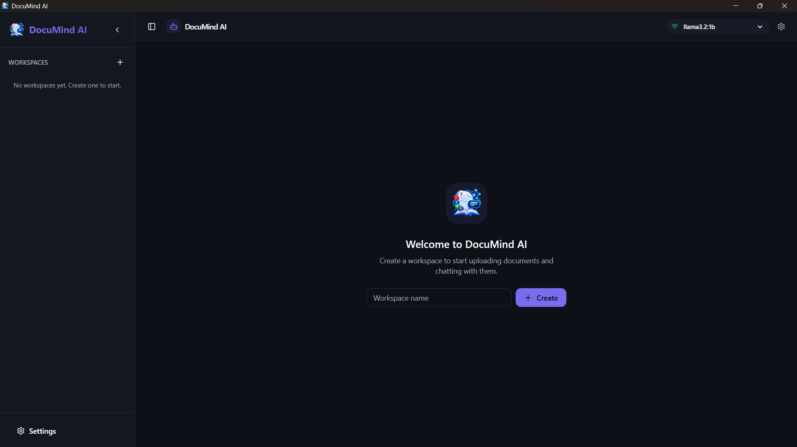
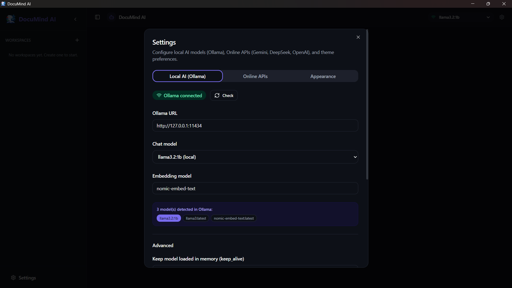
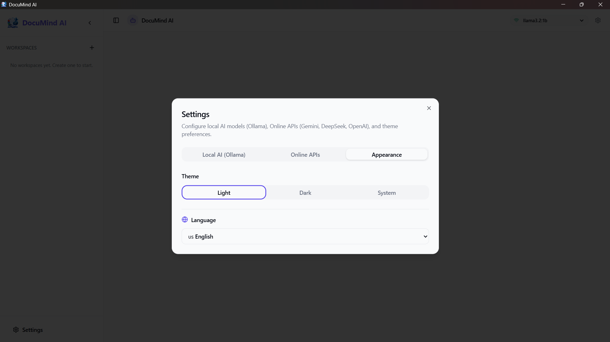
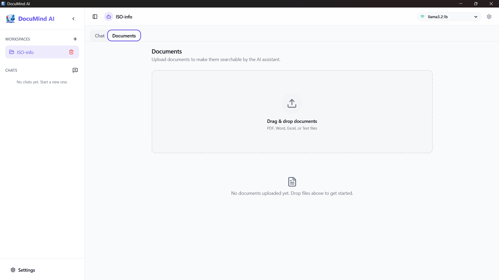
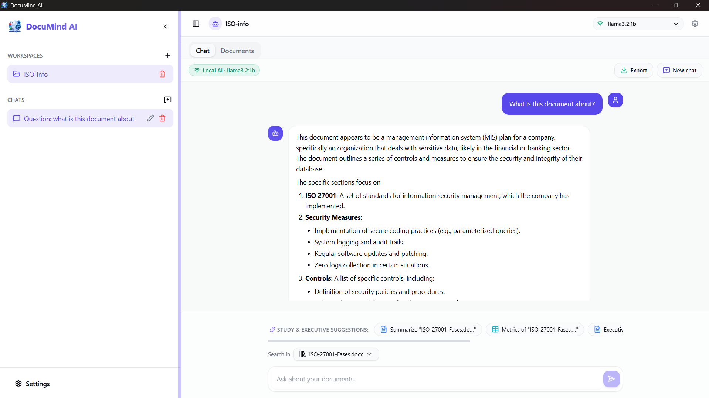

<div align="center">

# DocuMind AI Web

**Chatea con tus documentos. IA local por defecto, nube opcional con envío de pregunta y fragmentos.**

Landing page del software de escritorio **DocuMind AI**: una base de conocimiento personal que responde preguntas sobre tus PDF, Word, Excel y archivos de texto usando un modelo de lenguaje local.


[Ver la web](https://fguzman-stack.github.io/DocuMind-Ai-Web/) · [Cómo se publica](#publicación-en-github-pages) · [Empezar](#instalación)

</div>

---

## Índice

- [Funcionalidad](#funcionalidad)
- [Capturas](#capturas)
- [Cómo funciona](#cómo-funciona)
- [Seguridad y privacidad](#seguridad-y-privacidad)
- [Tecnologías](#tecnologías)
- [Requisitos](#requisitos)
- [Instalación](#instalación)
- [Uso](#uso)
- [Idiomas](#idiomas)
- [Publicación en GitHub Pages](#publicación-en-github-pages)
- [Autor](#autor)

---

## Funcionalidad

**DocuMind AI** es una aplicación de escritorio que convierte tus documentos en una base de conocimiento personal y te permite conversar con ella:

| Capacidad | Descripción |
| --- | --- |
| **100% local por defecto** | El parseo, los embeddings, la búsqueda y la generación corren en tu máquina desde la primera pregunta. |
| **Motor en la nube, opcional** | Activa Gemini, DeepSeek u OpenAI solo para redactar la respuesta final; la búsqueda sigue siendo local. |
| **Fuentes verificables** | Cada respuesta muestra los fragmentos exactos usados, con su puntaje de similitud, como en un artículo académico. |
| **Workspaces aislados** | Organiza documentos y chats en proyectos independientes; los datos nunca se mezclan. |
| **Progreso en tiempo real** | Una barra de avance muestra cada paso mientras se analizan, fragmentan e indexan tus archivos. |
| **Interfaz en 5 idiomas** | Inglés, español, portugués, francés y alemán, con detección automática del idioma del sistema. |

Formatos soportados: **PDF**, **DOCX**, **XLSX** y **TXT**.

---

## Capturas



| | |
|---|---|
|  |  |
|  |  |

---

## Cómo funciona

De un archivo a una respuesta con fuentes, en cinco pasos locales por defecto. Si activas la generación en nube, la pregunta y los fragmentos recuperados se envían al proveedor elegido:

1. **Analizar** — Extrae el texto de PDF, DOCX, XLSX o TXT. Los PDF usan un motor de respaldo si el primero falla.
2. **Fragmentar** — Divide el texto en piezas de 1000 caracteres con 50 de solape, para no cortar ideas a la mitad.
3. **Vectorizar** — Convierte cada fragmento en un vector de 768 dimensiones con `nomic-embed-text`, en grupos concurrentes.
4. **Indexar** — Guarda los vectores en SQLite, en lotes de 100 filas, listos para búsqueda por similitud.
5. **Responder** — Al preguntar, se buscan los 5 fragmentos más cercanos y se generan la respuesta y sus fuentes.

```
Documento → Fragmentos → Vectores → Motor local → Respuesta
```

---

## Seguridad y privacidad

- Con **Ollama local**, el procesamiento de documentos se realiza en tu equipo. Descarga previamente Ollama y los modelos para consultar sin conexión.
- Si activas **Gemini, DeepSeek u OpenAI**, se envían tu pregunta y fragmentos del texto recuperado al proveedor para generar la respuesta. Requiere internet y puede tener costos propios.
- Los archivos originales, los vectores y el historial se almacenan localmente. El texto de los fragmentos enviados sí forma parte del documento: no debe prometerse que todo el texto permanece siempre en el equipo.
- Las claves de API se usan para autenticar llamadas al proveedor elegido. No son créditos incluidos en la compra.
- El formulario de canje envía código y correo al servicio de validación. Un canje web no acredita por sí solo la activación ni los límites del escritorio; ver `CAMBIOS-COMERCIALES.md`.

---

## Tecnologías

La interfaz web está construida con HTML, CSS y JavaScript puros (sin frameworks), con diseño responsive y modo oscuro.

El software de escritorio detrás de la web usa:

| Capa | Tecnología |
| --- | --- |
| Shell de escritorio | Tauri 2 |
| Frontend | React 19 · TypeScript 5.8 · Vite 7 · Tailwind CSS |
| Estado | Zustand |
| Persistencia | SQLite |
| LLM local | Ollama (`llama3.2:1b`) |
| Embeddings | Ollama (`nomic-embed-text`, 768 dim) |
| Parseo | pdfjs-dist · mammoth · SheetJS |

---

## Requisitos

- Para compradores: **Windows 10/11 de 64 bits** y espacio adicional para Ollama y modelos.
- Ollama especifica **Windows 10 22H2 o posterior** y al menos **4 GB para instalar el runtime**, aparte de los modelos. No confundir esos 4 GB de disco con una garantía de RAM mínima o velocidad.
- Internet para descargar el instalador y preparar la IA local. Después, seleccionar el proveedor local para consultas offline.
- **No se necesita Node.js ni Rust para usar el instalador comercial**. Esas herramientas corresponden a compilar el código de la app, que está en otro repositorio.

---

## Instalación

1. Si compraste en AppSumo, abre el enlace de canje facilitado con tu compra, introduce código y correo y descarga el instalador de Windows. Conserva el comprobante.
2. Ejecuta el instalador y abre DocuMind AI. Usa el asistente para preparar Ollama y espera a que terminen las descargas de los modelos.
3. Crea un espacio, importa un documento y haz una pregunta. La nube es opcional; si la activas, se enviarán la pregunta y los fragmentos al proveedor.

Entrega actual: `DocuMind.AI_0.1.1_x64-setup.exe`, release `v0.1.1`, 7.094.626 bytes (aprox. 7 MB). MSI alternativo: 9.142.272 bytes. Los hashes están en `SHA256SUMS-0.1.1.txt` dentro de la release. Ollama/modelos requieren descargas aparte. Los instaladores no tienen firma Authenticode; no se afirma certificación de instalación limpia en todos los equipos.

### Pruebas locales de esta web

Con Node.js (verificado con 24.13.1): `node --test tests/commercial-flow.test.cjs`.

Las respuestas de canje son simuladas: no se llama al backend ni se gastan códigos. Las pruebas no sustituyen la comprobación del instalador o una prueba visual en navegador real.

### Modelo local y licencias

Built with Llama. El modelo predeterminado `llama3.2:1b` tiene su propia [Llama 3.2 Community License](https://github.com/meta-llama/llama-models/blob/main/models/llama3_2/LICENSE) y política de uso; no hereda la licencia MIT de Ollama. `nomic-embed-text` es un modelo de embeddings, no sirve como modelo de chat. La aplicación incorpora textos de licencia y avisos de terceros en el asistente de preparación; la distribución actual debe actualizarse y verificarse antes de afirmar que contiene estos cambios.

---

## Uso

1. Abre la app y crea o selecciona un **workspace**.
2. Arrastra tus documentos (PDF, DOCX, XLSX o TXT). Observa el progreso en tiempo real del análisis, fragmentación e indexación.
3. Haz preguntas sobre el contenido. Cada respuesta incluye sus **fuentes** con el puntaje de similitud.
4. Si lo deseas, configura una clave de API (Gemini, DeepSeek u OpenAI) para que la nube redacte la respuesta final. El resto sigue siendo local.

> La web que vive en este repositorio es la landing page: explica el producto, muestra sus capturas y guía la instalación. La app de escritorio en sí es otro proyecto.

---

## Idiomas

La interfaz se traduce automáticamente al idioma del sistema y permite cambiar manualmente entre:

- Español
- English
- Português
- Français
- Deutsch

---

## Publicación en GitHub Pages

El sitio es estático, por lo que se publica directamente desde la rama `main`:

1. Ve a **Settings → Pages** del repositorio.
2. En **Build and deployment → Source**, selecciona **Deploy from a branch**.
3. En **Branch**, elige `main` y carpeta `/ (root)`.
4. Guarda. En menos de un minuto el sitio queda disponible en:

```
https://fguzman-stack.github.io/DocuMind-Ai-Web/
```

No se necesita ningún archivo de configuración: no hay build, el contenido se sirve tal cual desde la raíz.

---

## Autor

**Francisco Guzmán**

- GitHub: [fguzman-stack](https://github.com/fguzman-stack)
- Proyecto: [DocuMind-Ai-Web](https://github.com/fguzman-stack/DocuMind-Ai-Web)
